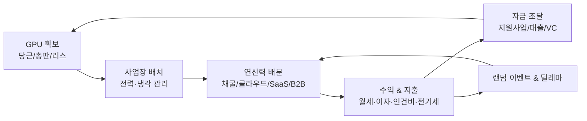

# 📘 GPU FOUNDER — 게임 기획서 (GDD) 인덱스

> **장르:** HTML5 경영 시뮬레이션 / 타이쿤  
> **콘셉트:** 당근마켓 GTX 1060 한 장으로 시작해, 한국 스타트업의 온갖 현실을 뚫고 국가급 AI 데이터센터까지.  
> **핵심 가치:** 플레이어가 **GPU 확보 방식 · 수익 모델 · 자금 조달 · 사업장 확장**을 모두 스스로 선택하는 자유도.

---

## 1. 핵심 게임 루프

## 2. 시스템 맵

| 시스템 | 문서 | 구현 상태 |
| :--- | :--- | :-: |
| 멀티 사업장 · 전력 · 발열 · 집주인 | [office.js](../game/js/systems/office.js) | ✅ 구현 완료 |
| GPU 조달 (당근/총판/리스) | [office.js](../game/js/systems/office.js) | ✅ 구현 완료 |
| 수익 포트폴리오 슬라이더 | [04_game_dev_tycoon_rules.md](references/04_game_dev_tycoon_rules.md) | ✅ 구현 완료 |
| 코인 거래소 & 코스닥 IPO 상장 | [office.js](../game/js/systems/office.js) | ✅ 구현 완료 |
| 인사 · 채용 · 번아웃 · 복지 | [01_hr_hiring_burnout.md](design/01_hr_hiring_burnout.md) | ✅ 구현 완료 |
| 랜덤 이벤트 & 딜레마 28선 (20+8) | [02_random_events.md](design/02_random_events.md) | ✅ 구현 완료 |
| 지원사업 / VC 피칭 압박면접 RPG | [03_pitching_minigame.md](design/03_pitching_minigame.md) | ✅ 구현 완료 |
| 하드웨어 튜닝 · 쿨링/전력 테크트리 · PUE | [04_hardware_tuning_techtree.md](design/04_hardware_tuning_techtree.md) | ✅ 구현 완료 |
| 멀티 엔딩 (배드4·히든2·트루2·만료5) | [05_endings.md](design/05_endings.md) | ✅ 구현 완료 |

## 3. 시간 체계
* **1게임월 = 60초**, 최대 7년(84개월)
* 계절 연동: 7~8월 전력 피크 할증 / 겨울 외기냉방 효율 ↑ / 6·12월 대학원생 기말 수요 폭증 / 2·8월 졸업 채용 시즌

## 4. 레퍼런스
| 게임 | 차용 요소 | 문서 |
| :--- | :--- | :--- |
| Startup Company | 서버실·발열·다운타임, 외주→자체서비스 | [01](references/01_startup_company_rules.md) |
| Software Inc. | 호스팅 계약, 특허, M&A, 사옥 환경 | [02](references/02_software_inc_rules.md) |
| Hardware Tycoon | GPU 스펙, 전성비, 수율 | [03](references/03_hardware_tycoon_rules.md) |
| Game Dev Tycoon | 3단계 거점 성장, 슬라이더 배분 | [04](references/04_game_dev_tycoon_rules.md) |
| 한국 스타트업 현실 | 지원사업, 지산, 신보/기보, 당근 | [05](references/05_korean_startup_reality_rules.md) |

## 5. 다음 구현 우선순위
1. 랜덤 이벤트 팝업 시스템 (02) — 몰입감 대비 구현비용 최저
2. 인사 시스템 (01) — 월급 고정비로 경영 긴장감 확보
3. 피칭 미니게임 (03) — 현재 확률 클릭 대체
4. GPU 개조 & 쿨링 테크트리 (04)
5. 엔딩 판정 (05) + 시간/계절 체계
