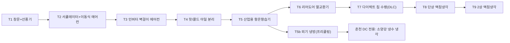

# 🔧 GPU 하드웨어 튜닝 · 개조 · 쿨링 테크트리

> 하드웨어 덕후용 엔지니어링 콘텐츠. GPU 개별 단위 튜닝 + 사업장 단위 쿨링 인프라 테크트리.

---

## 1. GPU 개별 상태값

| 스탯 | 설명 |
| :--- | :--- |
| `health` (0~100) | 내구도. 고온 가동·채굴에디션일수록 빠르게 감소. 0이면 고장 |
| `efficiency` | 전성비 배율 (기본 1.0). Watt당 TFLOPS |
| `clockMul` | 클럭 배율 (기본 1.0). TFLOPS·발열·전력 동시 영향 |
| `mods[]` | 적용된 개조 목록 |
| `warranty` | 신품 AS 잔여기간. **개조하면 즉시 소멸** |

```
실효 TFLOPS = 기본TF × clockMul × (health < 30 ? 0.7 : 1.0)
실효 전력   = 기본W × clockMul² / efficiency
발열        = 실효 전력 × 0.012
health 감소 = (온도 - 65)⁺ × 0.02 / 초  (채굴에디션 ×1.5)
```

---

## 2. GPU 개별 튜닝 / 개조

| 작업 | 비용 | 소요 | 성공률 | 성공 효과 | 실패 시 |
| :--- | ---: | :-: | :-: | :--- | :--- |
| **🔋 언더볼팅 (MSI Afterburner)** | 0원 | 즉시 | 90% | 전력 -15%, TF -3% | 불안정, 랜덤 다운 (재설정 필요) |
| **⚡ 오버클럭** | 0원 | 즉시 | 75% | TF +12%, 전력 +20% | 아티팩트 발생, health -10 |
| **🧴 서멀구리스 재도포 (MX-6)** | 2만 | 10초 | 95% | 온도 -6°C | 나사 뭉개짐 (health -5) |
| **🩹 서멀패드 교체 (겔리드)** | 8만 | 20초 | 85% | VRAM 온도 -12°C, health 감소 -30% | 두께 미스 → 코어 접촉 불량, 온도 +10 |
| **🌀 쿨링팬 교체** | 5만 | 10초 | 95% | 채굴에디션 쇳소리 제거, health 감소 -20% | — |
| **🧱 구리 방열판/백플레이트** | 15만 | 30초 | 80% | 온도 -8°C | 쇼트 5% (영구 고장) |
| **💾 VBIOS 롬플래싱** | 0원 | 15초 | 65% | 전력제한 해제 → TF +18% | **벽돌화 25%** (테크니션 보유 시 복구 가능) |
| **🧪 메모리 타이밍 스트랩 (채굴용)** | 0원 | 즉시 | 70% | 채굴 효율 +25% (AI 연산엔 효과 없음) | 메모리 에러, health -15 |
| **💧 개별 수랭 블록 장착** | 35만 | 60초 | 75% | 온도 -25°C, 오버클럭 성공률 +20%p | **누수 10%** → 인접 GPU 2대 피해 |
| **🔁 리볼링 (VRAM 재납땜)** | 40만 (외주) | 3일 | 60% | 고장 GPU 부활 (health 60) | 완전 사망 |

> 💡 **하드웨어 테크니션** 보유 시 모든 성공률 +15%p, 벽돌 복구 가능.  
> ⚠️ 개조 GPU는 당근마켓 재판매 시 가격 -30% ("개조품입니다" 고지 의무 이벤트).

---

## 3. 사업장 쿨링 테크트리



| 티어 | 이름 | 비용 | 냉각력 | 전력 소모 | 소음 | 필요 조건 |
| :-: | :--- | ---: | :-: | :-: | :-: | :--- |
| T1 | 창문 + 선풍기 | 3만 | 3 | 50W | 낮음 | — |
| T2 | 서큘레이터 + 이동식 에어컨 | 60만 | 8 | 900W | 중간 | — |
| T3 | 인버터 벽걸이 에어컨 | 120만 | 15 | 1.5kW | 낮음 | 집주인 허락 (원룸) |
| T4 | 핫/콜드 아일 분리 | 300만 | +30% 효율 | 0 | — | 랙 8개+ |
| T5 | 산업용 항온항습기 | 1,500만 | 45 | 6kW | 높음 | 지산 이상 |
| T5b | 외기 냉방 (프리쿨링) | 2,000만 | 겨울 60 / 여름 10 | 1kW | 중간 | 계절 연동 |
| T6 | 리어도어 열교환기 | 4,000만 | 90 | 4kW | 낮음 | 냉수 배관 |
| T7 | 다이렉트 칩 수랭 (DLC) | 1.2억 | 200 | 8kW | 낮음 | A100급 이상 GPU |
| T8 | 단상 액침냉각 (오일 탱크) | 3억 | 450 | 10kW | 매우 낮음 | 바닥 하중 보강 |
| T9 | 2상 액침냉각 (불화액) | 8억 | 1,200 | 12kW | 매우 낮음 | 환경부 인허가 이벤트 |
| ★ | 소양강 냉수 냉각 | 15억 | 3,000 | 5kW | — | 춘천 DC 전용, 지자체 협약 |

### PUE (전력효율지수)
```
PUE = (IT 전력 + 냉각 전력) / IT 전력
전기세 = IT 전력 × PUE × 단가
```
PUE 1.2 이하 달성 시 **그린 데이터센터 인증** → ESG 펀드 투자 해금, 전기요금 감면 10%.

---

## 4. 전력 인프라 테크트리

| 단계 | 이름 | 용량 | 비용 | 비고 |
| :-: | :--- | :-: | ---: | :--- |
| P1 | 가정용 단상 (누진제) | 3kW | — | 누진 3단계 폭탄 |
| P2 | 전용 회로 분기 공사 | 6kW | 50만 | 원룸은 집주인 동의 필요 |
| P3 | 일반용(갑) 저압 증설 | 20kW | 400만 | 한전 신청 2주 대기 |
| P4 | 산업용(을) 고압 수전 | 100kW | 3,000만 | 수변전실 + 전기안전관리자 선임 필수 |
| P5 | 특고압 22.9kV 수전 | 1MW | 3억 | 한전 계통 연계 심사 3개월 |
| P6 | 154kV 전용 변전소 | 20MW | 50억 | 지역 주민 반대 이벤트 |
| 보조 | UPS 무정전 전원 | — | 랙당 500만 | 차단기 트립 시 데이터 손실·위약금 방지 |
| 보조 | 옥상 태양광 | -10% 전기세 | 2,000만 | 재생에너지 인증 |
| 보조 | 디젤 비상발전기 | — | 5,000만 | 한전 정전 이벤트 무효화 |

---

## 5. 게임 데이터 (JSON)

```json
{
  "gpuMods": [
    { "id": "undervolt", "cost": 0,      "success": 0.90, "on": { "power": -0.15, "tflops": -0.03 }, "fail": { "instability": true } },
    { "id": "overclock", "cost": 0,      "success": 0.75, "on": { "tflops": 0.12, "power": 0.20 },   "fail": { "health": -10 } },
    { "id": "paste",     "cost": 20000,  "success": 0.95, "on": { "temp": -6 },                      "fail": { "health": -5 } },
    { "id": "pad",       "cost": 80000,  "success": 0.85, "on": { "temp": -12, "wear": -0.3 },       "fail": { "temp": 10 } },
    { "id": "fan",       "cost": 50000,  "success": 0.95, "on": { "wear": -0.2 } },
    { "id": "heatsink",  "cost": 150000, "success": 0.80, "on": { "temp": -8 },                      "fail": { "dead": 0.05 } },
    { "id": "vbios",     "cost": 0,      "success": 0.65, "on": { "tflops": 0.18, "power": 0.25 },   "fail": { "brick": 0.25 } },
    { "id": "memstrap",  "cost": 0,      "success": 0.70, "on": { "mining": 0.25 },                  "fail": { "health": -15 } },
    { "id": "waterblock","cost": 350000, "success": 0.75, "on": { "temp": -25, "ocBonus": 0.2 },     "fail": { "leak": 0.10 } },
    { "id": "reball",    "cost": 400000, "success": 0.60, "on": { "revive": 60 },                    "fail": { "dead": 1.0 } }
  ]
}
```
